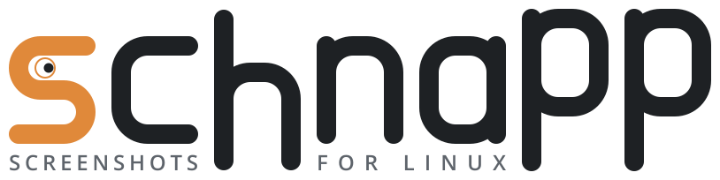

  <picture>
    <source media="(prefers-color-scheme: dark)" srcset="marke/logo/svg/schnapp-logo-dunkel.svg">
    
  </picture>

# Schnapp

*[English](README.md) · Deutsch*

Screenshot- und Beschriftungswerkzeug für Linux/Wayland — KDE Plasma zuerst. Vorbild ist die Arbeitsweise von Snagit:
schnell aufnehmen, beschriften (gerade und gebogene Pfeile, Kästen, Schritt-Nummern, Stempel), wirklich schwärzen, die
Mitte langer Seiten herausschneiden, teilen. Nebenbei ein einfaches Bildbearbeitungsprogramm.

## Stand

Frühe Arbeit — **noch nichts benutzbar**. Ein Prototyp hat die Oberflächen-Bibliothek bestätigt: Schnapp entsteht in Go
mit [Gio](https://gioui.org), dazu ein kleiner Patch an Gio (ein Vollbild-Overlay je Monitor, gebrochene Skalierung).
Die erste Fassung (0.1.0) wird geplant.

## Geplante Funktionen

- Bereich, Fenster oder Bildschirm unter KDE Plasma (KWin) aufnehmen, mit eingefrorenem Vollbild-Overlay auf jedem
  Monitor.
- Beschriften mit Vektorebenen: Pfeile (auch gebogen), Kästen, Text, Schritt-Nummern, Stempel.
- **Wirklich** schwärzen und verpixeln — geschwärzte Pixel fehlen in jeder gespeicherten oder exportierten Datei.
- Lange Screenshots stauchen, indem die Mitte herausgeschnitten wird, ohne das Original zu zerstören.
- Bibliothek mit automatischem Speichern, Suche und Schlagworten.
- Oberfläche auf Englisch und Deutsch; sie folgt der Systemsprache, sonst Englisch.

## Bauen

Ein Programm zum Bauen gibt es noch nicht. Vorhanden sind:

| Pfad | Was es ist | Prüfen |
|---|---|---|
| `.` (Wurzel) | Go-Modul `github.com/Andiministrator/schnapp`: bisher `sprache` (Sprachwahl, gettext-PO-Leser) und `po` (eingebettete Übersetzungen, `po/de.po`) | `go vet ./... && go test ./...` |
| `zeichnen/` | Go-Modul `github.com/Andiministrator/schnapp/zeichnen`: SVG lesen, Rasterer mit Kantenglättung, Rechenhilfen (nur Standardbibliothek) | `cd zeichnen && go vet ./... && go test ./...` |
| `marke/` | Logo, Farben und Corporate Design ([`marke/corporate-design.md`](marke/corporate-design.md), mit PDF) | `python3 marke/werkzeug/paket.py` erzeugt die Logo-Dateien neu |
| `extern/gio/` | Gio mit unserem Patch (Vollbild auf gewähltem Monitor, gebrochene Skalierung), eingebunden per `replace` in `go.mod` | `extern/gio-patch.sh pruefen`, siehe [`extern/README.md`](extern/README.md) |
| `prototyp/` | Wegwerf-Prototyp, der Gio geprüft hat (braucht Go ≥ 1.27, cgo, `libwayland-client`, `libwayland-egl`, `libwayland-cursor`, `libEGL`, `libxkbcommon`) | `prototyp/bauen.sh`, siehe [`prototyp/README.md`](prototyp/README.md) |

## Dokumentation

Die Dokumente für Nutzer und Beitragende (diese README, `CONTRIBUTING.de.md`) gibt es auf Englisch und Deutsch. Die
Arbeitsdokumente des Projekts — Anforderungen, Architektur-Entscheidungen (`docs/adr/`), QA-Listen, Befunde,
Recherchen (`knowledge/`) und das Corporate Design (`marke/`) — sind auf Deutsch.

## Hinweis zu KI

Der größte Teil von Code und Doku in diesem Repository wird von einem KI-Modell (Anthropic Claude) unter Anleitung und
Prüfung des Maintainers geschrieben. Entscheidungen stehen in `docs/adr/`. Siehe [`CONTRIBUTING.de.md`](CONTRIBUTING.de.md).

## Lizenz

GPL-3.0-or-later, siehe [`LICENSE`](LICENSE). Das Logo verwendet Umrisse von Open Sans (SIL Open Font License 1.1). Fremder Code behält seine Lizenz: Der Gio-Patch
(`extern/gio-ausgabe.patch`, angewendet in `extern/gio/`) gilt für Gio (Unlicense OR MIT) und enthält aus wayland-protocols erzeugten Code (MIT).
