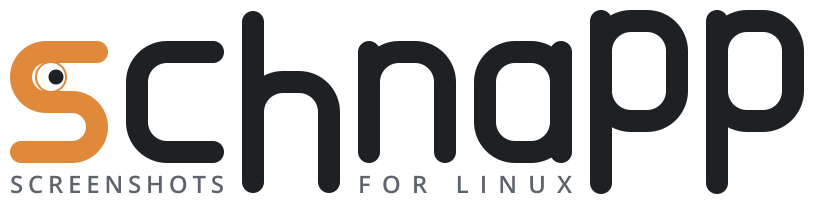

<p align="center">
  <picture>
    <source media="(prefers-color-scheme: dark)" srcset="brand/logo/svg/schnapp-logo-dunkel.svg">
    
  </picture>
</p>

# Schnapp

*English · [Deutsch](README.de.md)*

Screenshot and annotation tool for Linux/Wayland — KDE Plasma first. The workflow in short:
capture fast, annotate (straight and curved arrows, boxes, step numbers, stamps), redact for real, cut out the middle of long
pages, share. Also meant as a simple image editor.

## Status

Version 0.6.0 (KDE Plasma only) brings a new editor window — menu bar, tool bar on the left, sidebar on the right, footer — with layers, quick styles, speech bubbles, a magnifier, a navigator, snapping, a colour picker with opacity, text recognition (OCR), a bar of recent captures, a full library view and a settings dialog; scripts and AI agents can annotate and redact files without a window (`--annotate`) and use the MCP server `schnapp mcp`. Since 0.5.0 Schnapp opens PNG and JPEG files from the file manager ("Open with", JPEG rotated as its EXIF data says), can join all monitors into one image, saves faster, and draws text the same in the editor, in PNG/JPG and in SVG. Since 0.4.0 closing or quitting waits as long as a slow save still makes progress. Since 0.3.0 Schnapp saves and copies in the background: the window no longer freezes with large images (editing pauses until the save is done, copying and closing still work), and the menu works entirely from the keyboard. Schnapp captures on KDE Plasma (area, monitor, window; **Print** key), saves every screenshot to
the library and opens it in an editor where you draw arrows (straight or bent), boxes, text labels and step numbers
and select, move and resize them, black out or pixelate areas for good, crop, cut out the middle of a long screenshot
and copy the result to the clipboard. It is written in Go with the [Gio](https://gioui.org) UI library,
plus a small patch to Gio (one full-screen overlay per monitor, fractional scaling, cursor at mixed scales,
images on the clipboard). A part that
reaches the edge of the image is cropped off and comes back with *Image → Whole image*.

## Planned features

- Stamps (ready-made symbols such as check marks and warnings).
- Desktops other than KDE Plasma, through the desktop portal.
- PDF export.
- A Flatpak package.

## Building

Gio needs cgo (`libwayland-dev`, `libegl-dev`, `libxkbcommon-dev` or your distribution's equivalent) and the build tags `novulkan,nox11`, which you pass through `GOFLAGS` (no need to change your Go environment):

```sh
export GOFLAGS=-tags=novulkan,nox11
go build -trimpath -o schnapp ./cmd/schnapp
```

What exists:

| Path | What it is | How to check it |
|---|---|---|
| `.` (root) | Go module `github.com/Andiministrator/schnapp`: the program `cmd/schnapp` and its packages under `internal/`, among them `capture` (capture via KWin), `selection` (overlay logic), `canvas` (editor logic), `document` (layers, crop, redaction, undo), `fileformat` (working file and exports), `render` (layers to pixels), `library` (library), `settings` (`settings.ini`), `ui` (overlay and editor in Gio), `wlclip` (keeps a copied image on the clipboard after the editor closes), `portal` (file dialog of the desktop portal), `export` (export from the editor), `i18n` (language choice, gettext PO reader) and `po` (embedded translations, `internal/po/de.po`; template `schnapp.pot`); `data/` holds the desktop file template | `go vet ./... && go test ./...` (with `GOFLAGS` as above) |
| `draw/` | Go module `github.com/Andiministrator/schnapp/draw`: SVG parsing, an anti-aliased rasterizer, numeric helpers (standard library only) | `cd draw && go vet ./... && go test ./...` |
| `brand/` | Logo, colours and corporate design ([`brand/corporate-design.md`](brand/corporate-design.md), German, with PDF) | `cd brand/werkzeug && go run . paket` rebuilds the logo files |
| `third_party/gio/` | Gio with our patch (multi-monitor fullscreen, fractional scaling, cursor at mixed scales, images on the clipboard), used via `replace` in `go.mod` | `third_party/gio-patch.sh pruefen`, see [`third_party/README.md`](third_party/README.md) (German) |

## Usage

| Command | What it does |
|---|---|
| `schnapp` or `schnapp --region` | select an area in a frozen full-screen overlay (default, **Print**) |
| `schnapp --screen[=NAME]` | capture a monitor (without a name as set in the settings, `[capture] screen = all` joins all monitors into one image; `--list-screens` lists the names, sizes and scales) |
| `schnapp --window` | select a window |
| `schnapp --repeat` | capture the last area again |
| `schnapp --no-editor …` | capture without opening the editor afterwards |
| `schnapp --cursor …` | include the mouse pointer (`--no-cursor`: without; `[capture] cursor = yes` makes it the default) |
| `schnapp --delay=5 …` | wait 5 seconds (0 to 60) before capturing, with a countdown notification — to catch an open menu; *Cancel* on the notification stops it; `[capture] delay = 5` sets it for every capture, `--delay=0` overrides that |
| `schnapp FILE` | open a PNG or JPEG in the editor (also what "Open with" in a file manager runs; a JPEG with EXIF orientation is rotated or mirrored as image viewers show it, the EXIF data itself is not kept) |
| `schnapp --ignore-limit FILE` | open the file even if it has so many or such large annotations that rendering exceeds the compute budget (for your own work that grew past it) |
| `schnapp … --output=shot.png` | write the capture to `shot.png` (or `.jpg`, `.svg`) instead of the library, without the editor |
| `schnapp --export=out.png FILE` | export FILE as it looks in the editor, without a window |
| `schnapp --annotate=list.json FILE` | add arrows, highlighter and freehand strokes, boxes, ellipses, text, step numbers and redactions from a JSON list to FILE and save as the editor does, without a window (see [`docs/agents.md`](docs/agents.md)) |
| `schnapp --list-screens` | list the monitors with name, size and scale |
| `schnapp mcp` | run as MCP server for AI agents (off until allowed under `[agents]`, see [`docs/agents.md`](docs/agents.md)) |
| `schnapp … --json` | print the result (path and size, or the monitor list) as one line of JSON |
| `schnapp --version` | print the version |

Unless `--output` is given, every capture is saved to the library (`~/Pictures/schnapp/YYYY-MM/`) and its path printed on standard output before
the editor opens. Scripts and AI agents: see [`docs/agents.md`](docs/agents.md), including annotating and redacting a file without a window (`--annotate`) and the MCP server `schnapp mcp` (off until you allow it under `[agents]`). Settings live in `~/.config/schnapp/settings.ini`, for example `[capture] open-editor = false`, `[capture] seam = wave` (edge at cut-out seams: `tear`, `wave` or `zigzag`) or
`[general] language = de` (default `auto`: the language of the system). The editor's quick styles that you save yourself (the "+" in the right-hand panel) are kept next to it in `~/.config/schnapp/styles.ini`; Schnapp rewrites that file as a whole, so edit styles in the editor, not by hand. Your own colour swatches (the "+" below the hex field) are kept there too, in `~/.config/schnapp/colors.ini`, which Schnapp also writes itself. You can change all settings in the editor as well: *File → Settings…* (**Ctrl+,**) writes only the keys you change and keeps your comments; the *Agents* tab writes the file that `schnapp mcp` reads.

In the editor, tools: **V** select, **A** arrow (drag; **Shift** snaps to 45°; drag the middle handle to bend it; the sidebar's *Arrow style* picks the head at the start and at the end from a list with previews — filled, narrow, notched, open, half, dot, diamond, square, bar or *none*; none at both ends draws a plain line),
**H** highlighter (drag along a line of text; **Shift** keeps it horizontal; the colour multiplies the image, so dark text stays dark; yellow, green and pink as quick styles), **F** freehand (drag freely; the line is smoothed when you let go; **Shift**: straight line; the highlighter has a *Freehand* box in the sidebar), **R** box (**Shift**: square; for arrow, box, ellipse and magnifier the sidebar's *Line style* picks solid, dashed or dotted), **E** ellipse (**Shift**: circle; same colours, fill, line style and shadow as the box), **T** text (click, type, **Enter** confirms, **Shift+Enter** new line, **Esc** discards;
double-click a text to edit it), **K** speech bubble (drag from the spot it points at to where the text should sit, then type; a click places one; the handle at the tip moves only the tip; the “Tail” switch in the sidebar turns any text into a bubble and back), **N** step number (counts up by itself), **M** magnifier (drag over a spot: an enlarged copy appears next to it, linked by a line; source and copy move separately, the sidebar sets 2×, 3× or 4×; it shows the redacted pixels and nothing cropped away), **B** redact (drag over an area: black),
**P** pixelate (drag; a mosaic made only from the area's average colour and random noise, so it carries nothing of
what was there). Both overwrite the pixels of the image itself: they can be undone until you save (the undo history keeps at most 512 MiB of pixel copies, older steps fall away silently), after that they are
final and no saved or exported file contains the hidden content. An image copied with **Ctrl+C** before redacting
stays in the clipboard as it was. **C** crop (the whole image appears with a frame; drag its
edges or corners inwards, or drag a new frame — the part outside stays visible, darkened, so an edge can be pushed back
out; *Image → Whole image* or a double-click with the tool shows the whole image again), **X** cut out (drag across the part to remove — vertically to
remove rows, horizontally for columns; the seam shows a transparent gap between two torn paper edges (white in JPEG) — **Seam style** in the *Image* menu (once there is a seam) switches to a wave or a zigzag, `[capture] seam` sets the style of new screenshots; double-click a seam to bring the part back (each seam hides about 14 pixels of image on either side, scaled up on very large screenshots, and a seam closer to the edge than about 24 pixels is cropped off instead); a part
reaching the edge of the image is cropped off instead and comes back with *Whole image*). Both only hide: the original stays complete in the working
file, so redact anything secret before cropping it away — exports and the clipboard contain only the visible part.
Annotations lying entirely in a hidden part are hidden too (the footer says how many) and come back with it.
Pick a colour from the swatches in the sidebar on the right, or one of the four annotation colours in the list of the
colour field in the footer or of the colour swatch below the tools; it recolours the selected annotation. The swatches
below the hex and opacity fields are your own palette: **+** adds the current colour (at most 24), a right-click or
**Del** on a swatch removes it. The sidebar also takes any colour: drag in the colour
area and the hue and opacity sliders, type a hex code (`#RRGGBB`; `#RRGGBBAA` also sets the opacity) or an opacity in percent, reuse one of
the last eight colours (the grid next to the colour area), or pick a colour from the image with the eyedropper (the button at the right of the colour row; it reads the screenshot, not the
annotations). Every annotation has two colours, like in image editors: the **foreground** (line of arrows and
rectangles, the letters of text, the circle of a step number) and the **fill** (area of a rectangle, label behind text;
while the fill is chosen, the first swatch, with a red slash, leaves it empty). The swatches below the tools show both;
the colour section of the sidebar starts with one tab per colour — *Color*, *Fill* (only where there is one) and
*Shadow* (only while the shadow is on) — and the highlighted tab is the one the colour picker below changes; click a
tab or a swatch below the tools to choose it (a click on a swatch below the tools also opens the colour section of the sidebar), **⇄** (*Edit → Swap colors*, **Ctrl+Shift+X**) swaps them. Each drawing
tool keeps all of its own settings — colours, line width and style, arrow heads, font, shadow — and they carry over to
the next editor window (`~/.config/schnapp/tools.ini`, written when a window closes): switching tools never passes one
tool's settings on to another. Changing a selected annotation also changes the settings of its tool. Out of the box,
new text is white on red, the other tools red without fill.
Redaction always stays opaque. For text, the sidebar picks the font (the built-in Go and Go Mono or a font
installed in the usual font folders with a regular, bold or italic face), the size, bold, italic, underline, strike-through and the alignment of the lines; a file
that names a font missing on another computer shows the text in Go there and keeps the name. On large screenshots (4K and up) lines, text and step numbers start thicker and larger. A drawing tool stays active; **Esc** steps back: text input → drag → selection →
select tool. Drag an annotation or its handles to move, resize or bend it; it always stays partly inside the image. While you drag (also when drawing a new arrow, box or number), edges and centres snap to the edges and centres of other annotations and of the image, shown as thin orange guide lines; hold **Alt** to switch snapping off for that drag, or turn it off for good with *View → Snap to objects*. When you zoom in so far that the image no longer fits the window, a small **navigator** appears at the bottom right of the canvas: the whole image in miniature with an orange frame for the visible part. Click it to jump there, drag to move the view, or turn the mouse wheel over it to zoom; *View → Navigator* hides it.
**Several annotations at once:** with the select tool, **Shift+click** adds an annotation to the selection or takes it
out again, dragging on an empty spot inside the image draws a selection frame (everything entirely inside it is
selected; with **Shift** it adds to the selection), and **Ctrl+A** (*Edit → Select all*) selects every visible, unlocked
annotation. Dragging one of them moves all, **Del** deletes all, **Ctrl+D** duplicates all, each as one undo step. The
*Layer* menu aligns them (left, centres, right, top, bottom; from two) and distributes them evenly (from three). The
right sidebar then changes all selected annotations that have the setting — colour, fill, stroke width, line style,
arrow heads, shadow, font and quick styles (a quick style only those of its kind), as one undo step — and each tool
remembers the new value. Where the selected ones differ, the sidebar says *Mixed*, a colour swatch is split diagonally
and the *Shadow* box shows a dash. The handles stay on the last one selected; the others show a plain frame, the
sidebar heading and the footer say how many are selected. In the layer list, **Ctrl+click** adds a row to the selection
or takes it out, **Shift+click** selects the range from the row you last clicked without Shift; the row of the last
one selected is highlighted more strongly.
**Groups:** **Ctrl+G** (*Layer → Group*) groups the selected annotations, **Ctrl+Shift+G** ungroups them. A click on
any member then selects the whole group (Shift+click adds or removes the whole group, the selection frame takes a group
only if it encloses all of it), so arrow, text and number move, hide (**Ctrl+H**), lock (**Ctrl+L**) and duplicate as
one. To change a single member, click its row in the layer list; members carry a coloured stripe there.
The mouse wheel scrolls the view (with **Shift** sideways; on a touchpad, slide two fingers), **Ctrl**+wheel zooms at
the pointer (on a touchpad, Ctrl and two fingers); over the navigator the wheel zooms without Ctrl. To move the view, hold **Space** and drag (with every tool, also on a touchpad
without a middle button), drag with the middle button, drag the empty margin around the image, or use the navigator.
Keys: **Ctrl+O** (*File → Open…*) opens another PNG or JPEG in the same window through the desktop file dialog (the open screenshot is saved first; a file from outside the library is copied into it with its first change), **Ctrl+Z** undo, **Ctrl+Shift+Z**/**Ctrl+Y** redo, **Del** delete, **Ctrl+S** save,
**Ctrl+Shift+S** (*File → Save As…*) saves an editable copy (PNG with Schnapp's editing data, the whole original, author and tags included; a new file is readable only by you, a replaced one keeps its permissions) anywhere outside the library; the window keeps working on the screenshot in the library, and later changes do not reach the copy — use Export to share only the visible image,
**Ctrl+N** (*File → New capture*) starts a new screenshot in its own window, like the global shortcut (the open window stays as it is and may be in the picture; *File → New capture in 3 s / 5 s / 10 s* waits first),
**Ctrl+Shift+E** (*File → Export…*) export as PNG, JPG or SVG through the desktop file dialog (no editing data inside, redacted content stays gone; if replacing an existing file fails halfway and the old content cannot be restored, the footer names the file as damaged),
**Ctrl+C** copy the selected annotations or, without a selection, the finished image to the clipboard (**Ctrl+Shift+C**, *File → Copy image*, always copies the image; on compositors with the data-control protocol, such as KDE Plasma, the copy stays after the editor closes until something else is copied, for at most 12 hours; elsewhere only while the editor is open, and closing then stops once and warns that the clipboard holds the image only while the window is open), **Ctrl+0** fit, **Ctrl+1** 100 %, **Ctrl+W** close. Every shortcut also works with the mouse (only holding Shift or Alt while dragging, for 45° arrows and squares or for switching snapping off, and Shift+Enter for a new line in text stay keys). The editor window has a **menu bar** on top (the "s" of the logo, then *File, Edit, View, Image, Tools, Layer, Help*; the file name sits at its right), a **tool bar** on the left with the twelve tools as icons and the colour swatch below them (in low windows the buttons shrink), a **sidebar** on the right (*View → Sidebar*, **Ctrl+Shift+B**; it stays folded away in windows narrower than about 750 px, and in low windows it scrolls with the mouse wheel) with the current tool or the selected annotation, its colour, the line width of arrows and rectangles (− / +) and, for Cut out, the seam style, and a **footer** at the bottom: on the left the message or the hint for the current tool, on the right fields for the selection size, the pointer position in the image, the colour with its opacity (click: list of colours), the text size, the image size (with "(cut out)" when parts are squeezed), the zoom (click: list with fit and 25 to 400 %) and "saved" or "unsaved". The menus list all actions with their shortcuts (including **Restore cut-out areas**, which brings back everything removed with Cut out); hovering a tool button shows its name and key. **F1** (*Help → Keyboard shortcuts*) shows all shortcuts. The menus also work without a mouse: **F10** opens the first menu, **Tab** reaches the menu titles, **Enter** or **Space** opens one, **Left**/**Right** switch between menus, **Up**/**Down**, **Home** and **End** choose an entry, **Enter** runs it, **Esc** closes. The lists of the footer fields work the same way: **Tab** to the field, **Enter** opens the list.

**Layers**: every annotation is a layer of its own. The *Layers* section at the bottom of the sidebar lists them, topmost first, each with a small preview, its name, an eye (show/hide) and a lock; above the list the opacity of the selected layer (0–100 %). Drag a row to change the order, double-click it or press **F2** to rename it; the buttons below move it up or down, duplicate or delete it. The *Layer* menu holds these actions with keys (deleting is under *Edit*, **Del**): **Ctrl+D** duplicate, **F2** rename, **Ctrl+H** hide/show, **Ctrl+L** lock/unlock, **Ctrl+Page Up**/**Ctrl+Page Down** bring forward/send backward, **Alt+Page Up**/**Alt+Page Down** select the layer above/below. Hidden layers and layers at 0 % are left out of exports and of the copied image, but they stay in the working file — hiding is not redacting. Copying a hidden annotation itself (Ctrl+C with a selection) takes it along; pasted, it is visible. Locked layers cannot be selected or moved on the canvas.

**Right-click** on the canvas opens a context menu: on an annotation (which it selects, whatever tool is active — except crop and cut out, which never select) edit text (for text and speech bubbles), cut, copy, duplicate, delete, move a layer forward or back, hide, lock, rename, group or ungroup (where it applies), save its look as a quick style or swap its colours; on an empty spot copy, paste, export, copy text from the image, fit, 1:1 and, once cropped or cut, whole image. A second right-click while the menu is open opens it at the new spot. **Shift+F10** opens the same menu for the selection from the keyboard. A right-click on a preview in the recent captures bar or the full library view offers open, show in file manager (Dolphin, Nautilus and others that offer `org.freedesktop.FileManager1`), edit keywords (full view only) and move to trash; **Shift+F10** opens it for the focused preview.

**Quick styles**: the *Quick styles* section of the sidebar shows ready-made looks for the current tool (or the selected annotation) as small tiles; the one that matches has an orange frame. Click a tile (or reach it with **Tab**, move with the arrow keys, press **Space** or **Enter**) to apply it. **+** saves the current look as your own style (at most 16 per kind, kept in `styles.ini`), a right-click or **Del** removes one of your own. A style saved from a look with a drop shadow keeps the shadow (its tile has a dark edge at the bottom right); the built-in styles have none and leave an annotation's shadow as it is.

**Drop shadow**: every annotation can cast one. Tick *Shadow* in the sidebar (for the selected annotation, or for the next ones you draw); then click or drag on the *Direction* dial towards where the shadow should fall (it snaps to 15°, hold **Shift** for single degrees; with the dial focused the arrow keys turn it by 15°; the number beside it is the side the light comes from, as in Photoshop: 135° puts the shadow down and to the right), *Distance* and *Softness* are sliders with − and + beside them (one pixel per step), and a click on the *Color* swatch chooses the *Shadow* tab of the colour picker. The shadow starts black and fades out softly; lower its opacity in the colour picker for a lighter one. Each change of a selected annotation is one undo step, dragging a slider is one too.

**Copy and paste annotations**: with annotations selected, **Ctrl+C** copies them and **Ctrl+X** cuts them (*Edit* menu). **Ctrl+V** pastes them into the same or another screenshot — also in another Schnapp window, as long as the compositor offers the data-control protocol — at the same place in the visible image; if that place is outside the image or in a cut-out strip, they land in the middle of the window (beside a seam if needed), and pasting again at the same spot moves each copy a little down and to the right. Pasted annotations keep their size in pixels, groups stay groups, hidden and locked layers become visible and unlocked. Other programs receive a PNG of the copied annotations on a transparent background. **Ctrl+Shift+V** (*File → New from clipboard*) turns an image on the clipboard (PNG or JPEG, for example copied in a browser) into a new screenshot in the library and opens it. **Esc** cancels a read in progress; in an input field of the sidebar Ctrl+C/X/V work on the field. Schnapp reads the clipboard only when you press one of these keys, through the data-control protocol (KDE Plasma and other compositors that offer it).

**Copy text from image** (*Edit* menu, **Ctrl+Shift+T**) recognises text on the screenshot and copies it to the clipboard: drag over the text (**Enter** takes the whole visible image, **Esc** cancels); recognition runs in the background, the footer says how many characters were copied. It reads the image as it would be exported (with redactions, never the original) and runs locally with [Tesseract](https://github.com/tesseract-ocr/tesseract). If the package `tesseract` is installed (with the language data you need, for example `tesseract-data-eng`/`tesseract-ocr-eng`), Schnapp uses it with the language of the interface plus English, as far as installed. If it is missing or has no language data, Schnapp falls back to its own helper `schnapp-ocr` (installed next to `schnapp` by `install.sh`): the same engine compiled to WebAssembly with English and German built in, one language per run, several times slower; the footer shows its progress.

**Recent captures** (*View → Recent captures*, **Ctrl+Shift+R**): a bar below the image shows the latest screenshots of the library, newest on the left, with the time (today), "yesterday" or the weekday and date (with the year if it is not this year) and the size in pixels; the open one has a green frame and an orange dot while it has unsaved changes. Hovering a preview (or a long press) shows **✕** at its top right, which moves that screenshot to the trash (it can be restored from there; on the open screenshot it is saved first, the next older one opens — at the oldest the next newer — and only then the open one goes to the trash; what you copied with Ctrl+C stays in the clipboard; the only screenshot of the library stays); **Del** on a focused preview does the same. Click a preview (or reach it with **Tab**, move with **Left**/**Right**, **Home**, **End**, press **Enter** or **Space**) to open it in the same window: the open screenshot is saved first, as with **Ctrl+S**; if that fails, it stays open and the footer says why. Coming back to a screenshot you left in this window keeps its undo history (**Ctrl+Z** still works), as long as its file was not changed from outside and no redaction lies in the history; at most four are remembered this way. The mouse wheel scrolls the bar. Captures taken by AI agents do not appear there. The bar hides itself in low windows; whether it is shown is remembered in `[library] bar = yes|no`.

**Library** (*File → Library*, **Ctrl+Shift+L**, or the library button at the left of the bar): the whole library in the editor window instead of the image and its bars; menu bar and footer stay. Screenshots are grouped by month, newest first, each with its preview, date and time, size and keywords; the open one has a green frame, the keyboard focus an orange one. At the top: a keyword search (**Ctrl+F**; part of a keyword is enough), the time range (today, last 7 or 30 days, this year, all), a switch to show captures taken by AI agents (off each time the library opens) and **Back to image**. **Arrow keys** move between screenshots, **Home**/**End** jump, **Page Up**/**Page Down** turn a page, the mouse wheel scrolls. **Enter** or a double-click opens a screenshot in the same window (the open one is saved first, as for the bar), **Del** or the **✕** on a hovered preview moves it to the trash (it can be restored from there; the open one as in the bar, and the library view stays open), **F2** edits its keywords below the preview (comma-separated, **Enter** saves, **Esc** cancels; not for the open one), **Esc** goes back to the image. While the library is shown, tool keys and other shortcuts for the image do nothing; the *Edit* menu then holds *Open*, *Edit keywords*, *Move to trash* and *Search by keyword*.

**Selecting several screenshots** works in the recent captures bar and in the library view: **Ctrl+click** adds a preview to the selection or removes it (without opening it), **Shift+click** selects the range from the last one you clicked, **Ctrl+Shift+click** adds that range. From the keyboard: **Ctrl+Space** toggles the focused preview, **Shift** with the arrow keys (in the library view also **Home**, **End**, **Page Up**/**Page Down**) extends the range, **Ctrl+A** selects all shown. Selected previews are tinted orange with a tick at the bottom left. **Del**, the context menu and **Shift+F10** on a selected preview act on all selected ones: move them to the trash in one go or show them in the file manager. If the open screenshot is among them, the editor first switches to the nearest one that is not selected; if there is none, the open one stays and the others go. The **✕** on a preview always removes only that one. A plain click clears the selection; in the recent captures bar it also opens that screenshot, in the library view it only moves the focus. **Esc** clears the selection first, wherever the keyboard focus is (on the image too), and only the next **Esc** does what it did before (in the library view: back to the image); the selection only covers what is shown, so changing the search or time range drops what is no longer visible.

Changes are saved when the editor closes; **Ctrl+S** without changes writes nothing. Saving runs in the background: the window stays responsive and shows "Saving…", editing pauses until it is done. A file from outside the library
(`schnapp FILE`, *Open with*, *File → Open…*) opens without being copied; the footer says it is not in the library.
With the first change the editor saves it as a new screenshot in the library and works on that copy from then on: it
appears at the left of the recent captures, the footer names it, and the file itself stays untouched (if you redact in
the copy, saving warns that the original still shows the content). A file you only look at never enters the library.
Opening the same unchanged file again opens that screenshot with its annotations. If a library file cannot be updated (deleted, replaced or not writable), the
changes are saved as a new screenshot instead. If saving fails, the window stays open and says so; closing a second time
discards the changes. Ctrl+C in the terminal or logging out saves first. A file that is too costly to render is refused
when opening; `--ignore-limit FILE` opens it anyway.

### Rescue copy

While you edit, Schnapp keeps a small *rescue copy* of your unsaved work, so a crash, a killed process or a power cut does not lose it. It holds your annotations with their texts, the crop and the squeezed strips, and the redactions made since the last save, but no pixels. It lives in `~/.local/state/schnapp/rescue/` (`$XDG_STATE_HOME/schnapp/rescue/` if set), in a folder only you can read (mode 0700, files 0600), one file per opened file, named after the SHA-256 of the absolute path of the edited file. The copy itself records that path together with the size, modification time and SHA-256 of the file, which is how the editor knows it still fits. It is deleted after a successful save and when you close without changes. The next time you open the same, unchanged file, the editor restores it and says so in the footer; undo returns to the saved state. If the file has changed in the meantime, the copy is not applied but set aside as `….alt.json` in the same folder, and the footer names it. Every copy whose own modification time is more than 30 days old is removed when the editor starts, including one that was set aside or never applied. A second window on the same file does not write a rescue copy and says so; a lock file `<SHA>.lock` in the same folder tells the windows apart. While the library view changes the tags of a capture, a short-lived marker `<SHA>.um` sits next to it, so that a window opening that capture waits a moment and then restores the copy; a marker left behind by a crash holds nobody up and is removed by the cleanup at editor start once it is older than a minute.

## Install

`./install.sh` builds Schnapp (same requirements as under "Building"; the version comes from `git describe`, without a reachable tag it reads `0.0.0-dev+<hash>`, with changed files `0.0.0-dev+<hash>.dirty`) and installs it for the current user:

| File | Location |
|---|---|
| Program | `$PREFIX/bin/schnapp` (default `~/.local/bin/schnapp`) |
| Text recognition helper | `$PREFIX/bin/schnapp-ocr` (used when `tesseract` is missing) |
| Desktop file | `$XDG_DATA_HOME/applications/schnapp.desktop` (default `~/.local/share/applications/`) |
| Icon | `$XDG_DATA_HOME/icons/hicolor/scalable/apps/schnapp.svg` |

The desktop file lists PNG and JPEG, so file managers offer Schnapp under "Open with". It carries the absolute path of the program (KDE Plasma 6.7 and older bind the screenshot permission to it) and the default shortcut **Print** for "Capture Area". Spectacle uses **Print** as well: if both are installed, turn off Spectacle's shortcut in the system settings (Shortcuts). Make sure `~/.local/bin` is in your `PATH`.

Desktop tools may update their caches as well (menu database; the icon cache only if one exists). Remove it again with `./install.sh --uninstall` (deletes only these four files). If building `schnapp-ocr` fails (for example without network access for its Go modules), Schnapp is installed anyway and the script warns. `./install.sh --help` lists the options.

## Documentation

User-facing documents (this README, `CONTRIBUTING.md`) exist in English and German. The project's working documents
— requirements, architecture decisions (`docs/adr/`), QA checklists, findings, research notes (`knowledge/`) and the
corporate design (`brand/`) — are written in German.

The working file format (PNG with the private chunks `snAP` and `snAO`) is specified in English in [`docs/format.md`](docs/format.md), with example files in `testdata/format/`.

## AI disclosure

Most of the code and documentation in this repository is written by an AI model (Anthropic Claude) under the
direction and review of the maintainer. Decisions are recorded in `docs/adr/`. See [`CONTRIBUTING.md`](CONTRIBUTING.md).

## Licence

GPL-3.0-or-later, see [`LICENSE`](LICENSE). The logo uses outlines of Open Sans (SIL Open Font License 1.1). The Go modules compiled into `schnapp` are listed with their licences in [`THIRD-PARTY-LICENSES/`](THIRD-PARTY-LICENSES/README.md). Bundled third-party code keeps its own licence: the Gio patch
(`third_party/gio-ausgabe.patch`, applied in `third_party/gio/`) applies to Gio (Unlicense OR MIT) and contains code generated from
wayland-protocols (MIT); `internal/raster16` is taken from golang.org/x/image/vector (BSD-3-Clause, see
`internal/raster16/LICENSE`). The text recognition helper `schnapp-ocr` (module `ocr/`) contains Tesseract, Leptonica
and further third-party parts, listed with their licences in [`ocr/THIRD-PARTY-LICENSES/`](ocr/THIRD-PARTY-LICENSES/README.md);
this software is based in part on the work of the Independent JPEG Group.
