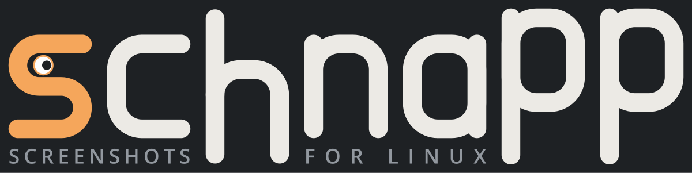
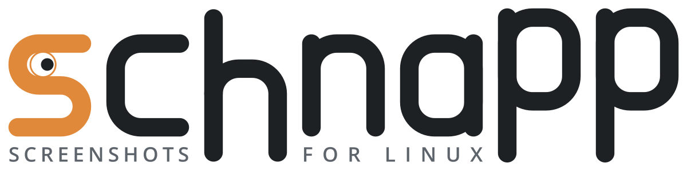
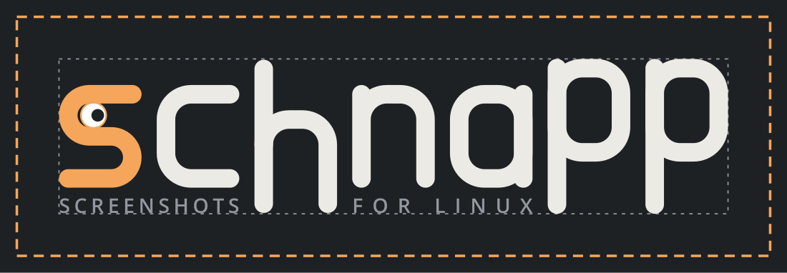
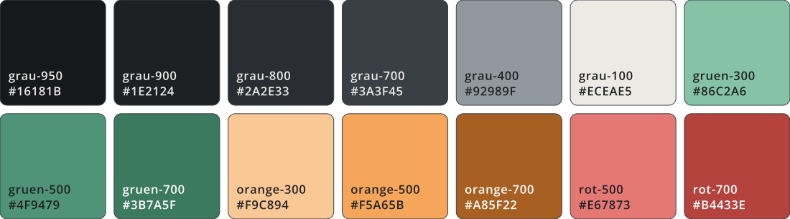
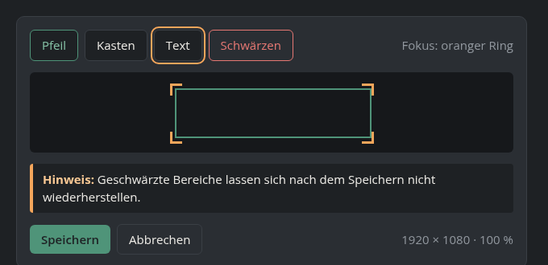

# Schnapp — Corporate Design

Fassung 1.0 · 19.11.2026 · Grundlage für Oberfläche, Doku, Webseite und alles, was nach außen geht.
Logo-Dateien: `brand/logo/` · Farben im Detail: `brand/farben.md` · Erzeugt aus `brand/werkzeug/` (nie Bilder von
Hand ändern).

## 1. Haltung

Schnapp ist **schnell, schlicht und ein bisschen frech**. Bedienung geht vor Funktionsfülle; das Werkzeug tritt
zurück, das Bild des Nutzers steht im Vordergrund. Die Persönlichkeit steckt in einem einzigen Detail: dem **Auge im
„s“**, das hinschaut, was aufgenommen wird.

- **Ruhig:** dunkelgrauer Grund, wenige Farben, viel Luft.
- **Klar:** eine Schrift für Text, Monoline-Formen für Zeichen, keine Effekte (Schatten, Verläufe, Glanz).
- **Freundlich:** runde Enden, abgerundete Ecken, kurze Texte in Alltagssprache.

## 2. Logo

### Aufbau

- **Schriftzug „schnapp“**, eigens gezeichnet: Monoline mit runden Enden, die Bögen sind abgerundete Rechtecke —
  wie ein Auswahlrahmen. Strichstärke 22 bei einer x-Höhe von 100.
- **h und pp** springen aus dem Band der kleinen Buchstaben: das h nach unten, die pp nach oben, beide gleich weit
  über und unter. Das gibt den Rhythmus „schnapp!“.
- **Das „s“** ist orange und trägt das **Auge**; die Pupille blickt nach rechts auf „chnapp“.
- **Unterzeile** „SCREENSHOTS“ unter „sc“ und „FOR LINUX“ unter „na“, Open Sans SemiBold in Großbuchstaben,
  gesperrt, Fuß bündig mit h und pp.

### Fassungen

| Fassung | Einsatz |
|---|---|
| mit Unterzeile, dunkel / hell | Standard: README, Webseite, Titel von Dokumenten, Präsentationen |
| ohne Unterzeile | klein (unter 320 px Breite), Kopfzeilen, Fensterleisten |
| einfarbig schwarz / weiß | Druck in einer Farbe, Prägung, Stempel, Aufkleber |
| Symbol (das „s“ auf Kachel) | App-Symbol, Favicon, Avatar, Systembereich |
| nur das „s“ freigestellt | Ladeanzeige, leere Zustände, kleine Markierungen |

„dunkel“ heißt: für dunklen Grund (helle Schrift); „hell“: für hellen Grund (dunkle Schrift).

### Schutzraum und Mindestgröße

Rund um das Logo bleibt **eine halbe x-Höhe** frei (gestrichelt orange): keine Schrift, keine Kante, kein anderes
Zeichen in diesem Raum.

| Fassung | Mindestbreite Bildschirm | Mindestbreite Druck |
|---|---|---|
| mit Unterzeile | 320 px | 50 mm |
| ohne Unterzeile | 100 px | 20 mm |
| Symbol | 16 px | 5 mm |

### Was nicht geht

- Logo verzerren, drehen, neu setzen oder in einer anderen Schrift nachbauen.
- h und pp auf die Grundlinie zurücksetzen, das Auge weglassen oder die Blickrichtung ändern.
- Andere Farben als die festgelegten Fassungen; das „s“ ist immer Orange (außer einfarbig).
- Schatten, Umrisse, Verläufe, Glanz; das Logo auf unruhige Bilder legen.
- Die Unterzeile übersetzen oder austauschen — sie bleibt Englisch.

## 3. Farben

Eine Palette für Logo **und** Oberfläche. Grund ist Dunkelgrau; **Grün** ist die ruhige Hauptfarbe, **Orange** die
markante Gegenfarbe, **Rot** nur für Fehler und Unumkehrbares.

| Rolle | Farbe | Hex |
|---|---|---|
| Fenstergrund | grau-900 | `#1E2124` |
| Tiefster Grund (Overlay-Abdunklung, Bildfläche) | grau-950 | `#16181B` |
| Leisten, Karten, Dialoge | grau-800 | `#2A2E33` |
| Linien, Ränder, Trenner | grau-700 | `#3A3F45` |
| Nebentext, deaktiviert | grau-400 | `#92989F` |
| Text | grau-100 | `#ECEAE5` |
| Hauptaktion, Auswahl, aktives Werkzeug | gruen-500 | `#4F9479` |
| grüner Text, Hover auf Grün | gruen-300 | `#86C2A6` |
| Akzent: Logo-„s“, Fokus, Hinweise, Auswahlecken | orange-500 | `#F5A65B` |
| oranger Text | orange-300 | `#F9C894` |
| Fehler, Gefahr, unumkehrbare Aktion (Schwärzen) | rot-500 | `#E67873` |
| Auf weißem Grund: Grün / Orange / Rot | gruen-700 / orange-700 / rot-700 | `#3B7A5F` / `#A85F22` / `#B4433E` |
| Logo hell: das „s“ (nur im Logo, nie für Text) | Logo-Orange hell | `#E0893A` |

**Kontraste** (WCAG, gerechnet): Text grau-100 auf grau-900 13,5:1; gruen-500 4,5:1; orange-500 8,1:1; rot-500
5,6:1; grau-400 5,6:1 (auf grau-800 4,7:1). Grüner **Text** auf dunklem Grund immer in gruen-300; gruen-500 für Flächen, Linien und
Symbole.

**Regeln**

- Höchstens eine Akzentfarbe je Bereich; Grün und Orange nie gleich stark nebeneinander.
- Grün nie auf grau-700-Flächen (2,96:1).
- **Farbe nie als einziges Merkmal**: Grün, Orange und Rot sind für Menschen mit Rot-Grün-Schwäche schwer zu
  trennen — immer Symbol, Form oder Text dazu.
- Die **Beschriftungsfarben im Editor** (Pfeile, Kästen, Text auf dem Bild) sind eine eigene Auswahl für Bilder und
  gehören nicht zu dieser Palette.

## 4. Schrift

| Zweck | Schrift |
|---|---|
| Logo-Schriftzug | gezeichnet, keine Schrift — nie nachsetzen |
| Oberfläche, Doku, Webseite (Hausschrift) | **Open Sans** Regular (400) und SemiBold (600) |
| Unterzeile, Abschnittsmarken | Open Sans SemiBold, GROSSBUCHSTABEN, gesperrt (+ 10 – 20 %) |
| Code, Pfade, Maße | die Monospace-Schrift des Systems |

Open Sans steht unter der SIL Open Font License 1.1 und soll mit dem Programm ausgeliefert werden (gleiche Darstellung
auf jedem System); dann gehören OFL-Text und Urhebervermerk unter `licenses/` ins Repo. Größen in der Oberfläche: Grundtext 14 px, Nebentext 12 px, Überschriften 18 / 16 px; Zeilenhöhe 1,4.

## 5. Formen

- **Monoline:** eine Strichstärke je Zeichen, runde Enden und Ecken — für Symbole, Werkzeugzeichen, Markierungen.
- **Abgerundete Rechtecke** als Grundform: Radius 6 px für Schaltflächen und Felder, 10 px für Karten und
  Dialoge, rund 23 % der Kantenlänge beim App-Symbol.
- **Auswahlecken** (vier Winkel) als Motiv für alles, was „Bereich“ bedeutet.
- Abstände im **4-px-Raster** (4, 8, 12, 16, 24, 32).

## 6. Oberfläche

- **Dunkles Thema ist Standard.** Ein helles Thema folgt später mit den „-700“-Farben auf Weiß.
- **Hauptaktion** (z. B. Speichern) grün gefüllt mit dunkler Schrift; **Nebenaktion** nur umrandet;
  **gefährliche Aktion** (Schwärzen, Löschen) rot umrandet, mit Bestätigung, wenn sie unumkehrbar ist.
- **Aktives Werkzeug:** grüner Rand, grüne Schrift (gruen-300).
- **Tastaturfokus** immer sichtbar: 2 px orangener Ring mit 2 px Abstand. Ausnahme Menüeinträge: Ring innen, 2 px breit, 2 px vom Zeilenrand (ADR-0026 Nachtrag 3).
- **Auswahl** auf dem Bild: grüne Linie, orange Eckgriffe, der Rest abgedunkelt mit grau-950.
- **Hinweise:** orangener Balken links; **Fehler:** roter Balken links, immer mit Text.

## 7. Das Auge

Das Auge ist die einzige Figur von Schnapp. Es wird **sparsam** eingesetzt — nie mehr als einmal im Blick:

- **Aufnahme:** blinzelt einmal kurz, wenn ein Bild „geschnappt“ ist.
- **Laden, Warten:** schaut langsam hin und her.
- **Leere Zustände** (z. B. Bibliothek leer): das freigestellte „s“ mit fragendem Blick nach oben.
- Bewegungen kurz (unter 300 ms) und abschaltbar; bei „Bewegung reduzieren“ des Systems bleibt es still.

## 8. Sprache

- **Englisch** ist die Ausgangssprache, **Deutsch** die erste Übersetzung (ADR-0014).
- Kurz, aktiv, freundlich: „Saved to library“ / „In der Bibliothek gespeichert“ statt Fachsprache.
- Schaltflächen nennen die Handlung („Save“, „Speichern“), nicht „OK“.
- Ansprache im Deutschen: möglichst ohne Anrede („Bild gespeichert“, „Bereich wählen“); wo nötig **„du“** (E-13).

## 9. Dateien und Werkzeuge

| Was | Wo |
|---|---|
| Logo, Symbol, Favicon, Vorschaubild | `brand/logo/` (README dort) |
| Farben mit Kontrasten | `brand/farben.md` |
| dieses Dokument | `brand/corporate-design.md` und `.pdf` |
| Erzeugung | Go-Werkzeug `brand/werkzeug/`: `go run . paket` (Logo-Paket), `go run . cd` (Bilder und PDF dieses Dokuments) |
| Entwürfe und Herleitung | `brand/entwuerfe/runde-6`; Runden 1–5 in der git-Geschichte (Commit `be353c9`) |

Neu bauen: `cd brand/werkzeug && go run . alles`. Braucht Go, Open Sans
SemiBold (Pfad über `SCHNAPP_SCHRIFT`, Vorgabe Arch), `rsvg-convert`, ImageMagick, `chromium` und `qpdf`.
